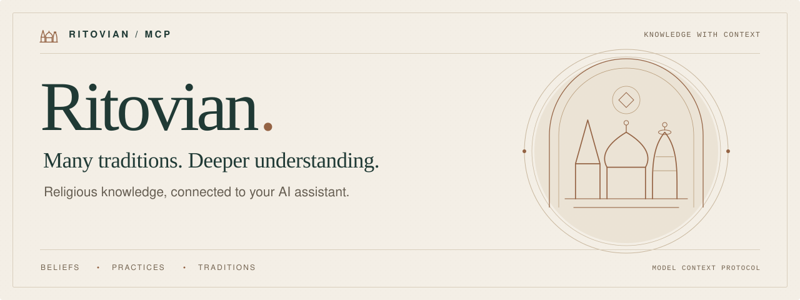

<div align="center">

<picture>
  <source media="(prefers-color-scheme: dark)" srcset="assets/banner-dark.svg">
  <source media="(prefers-color-scheme: light)" srcset="assets/banner-light.svg">
  
</picture>

<br/>

[](#build-status)
[](https://modelcontextprotocol.io/)
[](LICENSE)

**[The hub](#the-shared-knowledge-hub)** &nbsp; · &nbsp; **[Sources & citations](#sources-and-citations)** &nbsp; · &nbsp; **[Build status](#build-status)** &nbsp; · &nbsp; **[Release plan](docs/RELEASE-PLAN.md)**

</div>

<br/>

## The idea

Faith is lived in many ways. Understanding it starts with better questions.

**Ritovian MCP** is the AI-facing part of a planned shared religious knowledge hub: the beliefs people hold, the traditions they inherit, and the practices that shape their communities, explained by the organisations that contribute to it.

Organisations joining [Ritovian](https://ritovian.com) will be able to contribute knowledge, support their blog posts with citations, and choose to share full articles on the Ritovian hub.

Using the [Model Context Protocol](https://modelcontextprotocol.io/), AI assistants will retrieve the same published knowledge people can read on the hub, with its sources, contributor and religious context attached.

## The shared knowledge hub

The planned contribution model has four parts:

1. **Contribute knowledge.** An organisation publishes an explanation, definition or guide in the relevant religious category, with sources and clear attribution.
2. **Support a post.** Its authors attach citations to particular points in a blog post, linking to hub knowledge and original references.
3. **Share the full article.** The organisation can also publish the complete post on the Ritovian hub, with its byline, citations and a link to the original website.
4. **Keep it current.** Published revisions make updates traceable and preserve the version a post originally cited.

```text
Organisation knowledge + sources
              |
       Published hub knowledge
              |
       +------+-------+
       |      |       |
       v      v       v
    Readers  MCP   Blog citations
                       |
              Organisation's website
                       |
              Optional full article
              on the Ritovian hub
```

Hub article sharing is an organisation's choice for each post. Knowledge entries retain their contributor and tradition, family or denomination, so the context travels with the explanation.

## Sources and citations

A useful answer should let you follow the references:

**Statement in a blog post → cited knowledge passage → original source.**

The planned citation system will identify the relevant passage, its published revision, the contributing organisation and its underlying references. Sources can include texts, official publications, research and accounts of a community's own practice.

When an entry changes, an existing citation will still identify the version it used. Public pages and MCP results will draw from the same published-content service.

## A wider lens

The knowledge service is being designed around these areas:

| Explore | Understand |
| :--- | :--- |
| **Beliefs & teachings** | Ideas, texts and teachings within their religious and denominational context. |
| **Practice & worship** | The meaning behind rituals, gatherings and everyday observances. |
| **Festivals & calendars** | What communities commemorate, how they observe it, and why dates can differ. |
| **Words & meanings** | Religious vocabulary explained clearly, with attention to language and tradition. |
| **Community & visiting** | What to expect when visiting a place of worship or learning about a community. |

## Questions worth asking

A few examples of the questions this project is being designed to support as contributors build out its coverage:

> “What should I know before visiting a synagogue for the first time?”

> “Why do Eastern and Western Christian communities sometimes celebrate Easter on different dates?”

> “What is langar, and what does it mean in Sikh tradition?”

> “Why can the start of Ramadan differ between communities?”

## Understanding is in the details

Three principles guide the project:

**01 — Keep the context.** A practice belongs to a particular tradition, place and community. Those details are part of the answer.

**02 — Keep the sources close.** Explanations should make it easy to see where information comes from and explore it further.

**03 — Make room for difference.** Beliefs and practices vary within religions as well as between them. A useful answer reflects that variety.

## Build status

**Pre-release planning.** The Ritovian application already contains platform and organisation MCP endpoints. The shared knowledge hub and its contribution, citation and article-sharing features are planned additions.

| Area | State |
| :--- | :--- |
| Platform information and organisation MCP endpoints | Implemented in the application source. |
| Organisation-contributed knowledge and sources | Planned. |
| Revision-pinned blog citations | Planned. |
| Optional full-article publishing to the hub | Planned. |
| Hub knowledge and article retrieval through MCP | Planned. |
| Public MCP release and registry listing | Planned after the application launch and hub pilot. |

This repository holds the public-facing documentation, artwork and release plans. The hosted server implementation currently lives in the Ritovian application.

### Connecting

The intended hosted transport is **Streamable HTTP**. Tested connection instructions, the released tool list and actual tradition coverage will be published here when the knowledge service is ready. The [release plan](docs/RELEASE-PLAN.md) describes that sequence.

### Project plans

| Document | What it covers |
| :--- | :--- |
| [Knowledge hub plan](docs/KNOWLEDGE-HUB.md) | Contributions, religious categories, sources, blog citations, full-article sharing and the proposed data model. |
| [MCP release plan](docs/RELEASE-PLAN.md) | The post-application-launch pilot, beta, hosted release, registry publication and ongoing updates. |
| [Changelog](CHANGELOG.md) | Repository changes and, once published, released MCP capabilities. |

## Get involved

Have a question the service should help answer? Know a useful source, or spotted wording that needs more context? [Open an issue](https://github.com/Ritovian/MCP/issues) and help shape the project. Please include the relevant tradition or community and links to the sources you suggest.

Contributions from people with lived experience, religious educators, researchers and developers are welcome.

## Licence

[MIT](LICENSE) · Copyright © 2026 Ritovian.

The repository's MIT licence does not automatically cover contributed knowledge, articles or third-party sources. Content attribution and reuse terms will be published with the hub.

<br/>

---

<div align="center">

<br/>


<br/>
<br/>

<strong>Many traditions. A shared curiosity.</strong>

<sub><a href="https://ritovian.com">Ritovian</a> · One platform. Every faith. Every community. · <a href="CHANGELOG.md">Changelog</a></sub>

</div>
